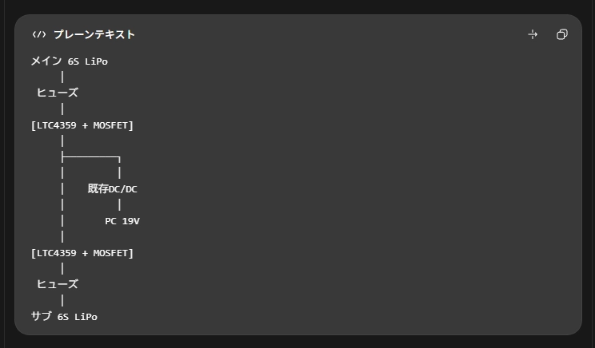

# 回路構成

- 動作原理

    今回の回路は、2つのバッテリーのうち電圧が高い方から、自動的にPCへ電力を供給するという仕組みです。

    秋月電子で購入できる理想ダイオードモジュール「AE-LTC4358」を2個使用する場合を例に説明します。

## 回路の基本原理

例：メイン20V、サブ25Vの場合。サブから既存DC/DCへ給電されます。GND等は省略。

普通のダイオードは、電流を一方向にだけ流す部品です。

今回の回路では、各バッテリーのプラス側にダイオードを接続して、ダイオードの出力を合流させます。これをダイオードOR回路と呼びます。

- 電圧の高いバッテリーから電流が流れる。
- 電圧の低いバッテリー側には電流が逆流しない。
- 高い方のバッテリーを抜くと、残ったバッテリーから給電される。

この動作は、マイコンで電圧を測定して切り替えなくても自動的に行われます。

## やってみた

部室にあった、

RBQ30NS65ATL | DigiKey Electronics
https://www.digikey.jp/ja/products/detail/rohm-semiconductor/RBQ30NS65ATL/13548004

できちゃった…
<video controls src="VID_20261020_154544.mp4" title="<video controls src="./VID_20261020_154544.mp4">
</video>

## 基板

### 仕様

| 項目                                   | 仕様・方針                                         |
| -------------------------------------- | -------------------------------------------------- |
| バッテリー                             | 6S LiPo × 2                                        |
| バッテリー公称電圧                     | 22.2 V / 本                                        |
| バッテリー満充電電圧                   | 25.2 V / 本                                        |
| 電源OR方式                             | ショットキーダイオードによるダイオードOR           |
| 電源OR部品                             | ROHM RBQ30NS65ATL × 1（共通カソード、2素子入り）   |
| TVS                                    | Bourns SMBJ26A を使用する方針                      |
| バッテリー入力前段の追加直列ダイオード | 設置しない                                         |
| MOSFET等による過電圧遮断回路           | 実装しない                                         |
| DC/DC                                  | 既存品を利用、19 V出力                             |
| DC/DC入力上限                          | 30 Vとの情報あり（動作上限か絶対最大定格か要確認） |
| PCへの無停電切替                       | 目標。実機で要確認                                 |

機能

| 機能                        | 目的                         |
| --------------------------- | ---------------------------- |
| 放熱対策                    | ダイオードの発熱を逃がす     |
| ヒューズ                    | 短絡や過電流への対策         |
| 平滑コンデンサ C1           | 電源切替時の電圧変動を緩和   |
| セラミックコンデンサ C2・C3 | 高周波ノイズ低減             |
| 電圧測定端子 ×3             | メイン・サブ・出力電圧を測定 |
| TVSダイオード               | サージ電圧への対策           |
| 電圧監視回路                | バッテリー交換時期の通知     |
| バッテリー接続LED ×2        | バッテリーの接続状態を表示   |

### 使用する部品

| 区分                 | 部品                        |   数量 | 主な仕様・用途                                                               | 状態                       |
| -------------------- | --------------------------- | -----: | ---------------------------------------------------------------------------- | -------------------------- |
| 電源OR               | ROHM **RBQ30NS65ATL**       |      1 | 2素子内蔵・共通カソードのショットキーダイオード。逆耐圧65 V級。2入力をOR接続 | 採用決定                   |
| サージ抑制           | Bourns **SMBJ26A**          |   1～2 | 単方向TVS、スタンドオフ電圧26 V、600 W級（規定パルス）。電源-GND間に並列接続 | 型番決定、個数・位置未確定 |
| 電源入力保護         | ヒューズ F1/F2              |      2 | 各バッテリー入力の過電流・短絡対策。電池・配線・コネクタに合わせて定格選定   | 選定中                     |
| 平滑                 | 電解コンデンサ C1           |      1 | 仮候補：470～1000 µF、耐圧35 V以上（50 Vも検討）                             | 選定中                     |
| 高周波デカップリング | セラミック C2               |      1 | 仮候補：1 µF、50 V                                                           | 選定中                     |
| 高周波デカップリング | セラミック C3               |      1 | 仮候補：0.1 µF、50 V                                                         | 選定中                     |
| 入出力接続           | バッテリー・DC/DC用コネクタ | 必要数 | 10 A以上の実使用電流・誤接続防止を考慮                                       | 選定中                     |
| 確認用               | 電圧テストポイント          |   適宜 | MAIN / SUB / V_SYS / GNDの計測                                               | 検討中                     |
